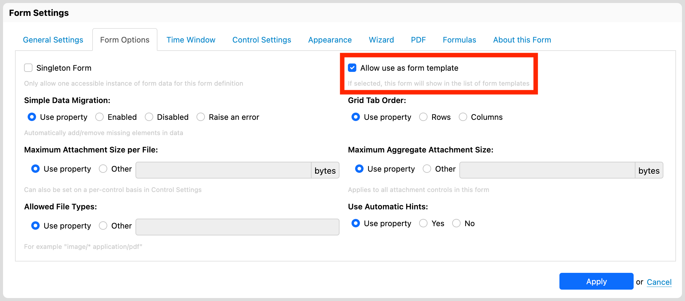

# Form templates

## Availability

[\[SINCE Orbeon Forms 2024.1\]](/release-notes/orbeon-forms-2024.1.md)

## Introduction

When you create a new form, you can start from a blank form or from a template. There are two predefined templates:

- Blank form
- Wizard form

You can also make your own templates: open the [Form Settings](form-settings.md#form-options) of a form, and check "Allow use as form template". That form then shows in the list of templates of the "New Form" dialog.

<figure><figcaption>
Marking a form as available as a template
</figcaption></figure>
