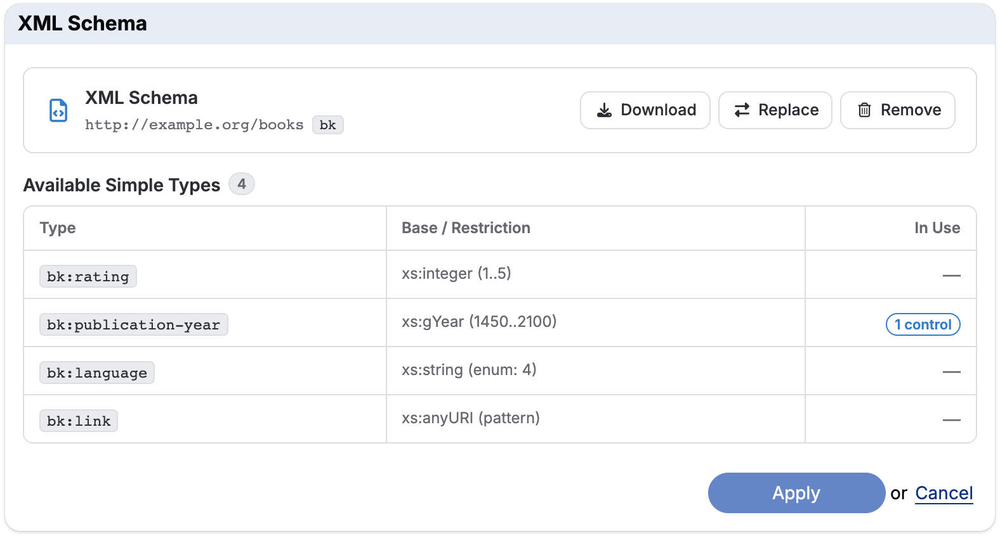
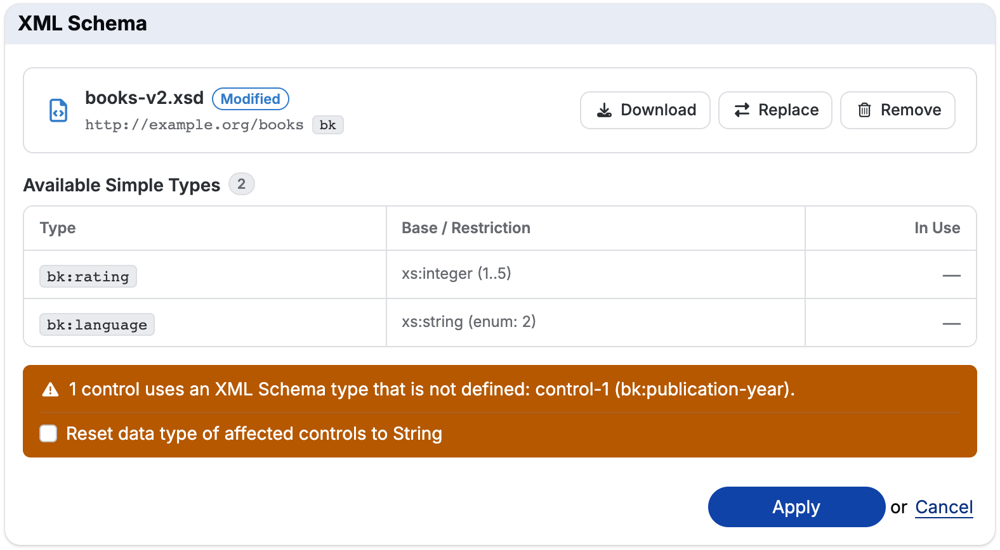

# XML Schema Support

## Availability

This is an [Orbeon Forms PE](https://www.orbeon.com/download) feature.

## Why use an XML Schema?

Form Builder already provides [built-in data types, common constraints, and XPath formula validations](validation.md) for everyday validation needs. Attaching an XML Schema (`.xsd`) to a form is useful when you want to:

* **Reuse existing organization or industry standards**: Plug corporate or standards-body simple types (such as account numbers, reference codes, SKUs, or ISO codes) directly into Form Builder without rewriting and maintaining equivalent regular expressions or range formulas by hand.
* **Share domain types across multiple controls**: Define a constrained type once (for example, a `1..5` rating or a publication year range) and assign it to any number of fields in the form from **Control Settings**.
* **Combine XML Schema facets declaratively**: Express patterns (`xs:pattern`), enumerations (`xs:enumeration`), length bounds (`xs:length`, `xs:minLength`, `xs:maxLength`), value bounds (`xs:minInclusive`, `xs:maxInclusive`), whitespace rules (`xs:whiteSpace`), lists (`xs:list`), and unions (`xs:union`) using standard W3C XML Schema 1.0 syntax.
* **Validate XML data structure**: Optionally enforce structural rules on the XML form data document itself in addition to per-control data types.

## The XML Schema dialog

You open the **XML Schema** dialog from the toolbox under **Advanced** -> **Attachments** -> **XML Schema**.

[\[SINCE Orbeon Forms 2026.1\]](../release-notes/orbeon-forms-2026.1.md)

The **XML Schema** toolbox button displays a `1` badge whenever a schema is attached to the form, and the redesigned **XML Schema** dialog provides validation, type inspection, and dangling-type handling:



* **Staged upload and validation**:
  * Drag and drop an `.xsd` file (or select one from disk) to stage it in the dialog.
  * Form Builder immediately verifies that the file is well-formed XML, has an `<xs:schema>` root element, and compiles cleanly as an XML Schema grammar. If not, an inline error message explains the problem and **Apply** remains disabled.
  * Uploading, replacing, or removing a schema is staged inside the dialog (`New` or `Modified` badge) and only takes effect when you click **Apply**. Clicking **Cancel**, closing the dialog, or pressing `Esc` discards staged changes and keeps the previously saved schema intact.
* **Attached schema card and actions**:
  * Shows the uploaded filename (or *XML Schema* when reopening an existing form), the schema's `targetNamespace` URI, and its bound namespace prefix badge (if any).
  * **Download** exports the currently staged or attached `.xsd` file.
  * **Replace** toggles the upload dropzone to stage a new `.xsd` file over the current one.
  * **Remove** stages removal of the attached schema.
* **Available Simple Types table**:
  * Lists every top-level `<xs:simpleType>` defined in the schema across three columns:
    1. **Type**: The qualified name (`prefix:name` when the schema declares a `targetNamespace` with a prefix, or `name` for a no-namespace schema) as it appears in **Control Settings**.
    2. **Base / Restriction**: A concise summary of the type's base type and facets (for example `xs:integer (1..5)`, `xs:string (enum: 4)`, `xs:anyURI (pattern)`, `list (...)`, or `union (...)`).
    3. **In Use**: How many controls in the form currently reference that type (hovering the pill lists the control names).
* **Handling dangling types on Replace or Remove**:
  * If you remove a schema or replace it with one that drops simple types still referenced by form controls, the dialog displays a warning listing the affected controls and types:

    

  * Select **Reset data type of affected controls to String** (unchecked by default) before clicking **Apply** to automatically reset those controls back to `xs:string`.
  * If you leave the checkbox unchecked and click **Apply**, Form Builder keeps the control bindings as-is without failing at design time. You can reset them later either by reopening the **XML Schema** dialog or by selecting a built-in type in **Control Settings** -> **Validations and Alerts** on each affected control.

## Examples

### Simple types with a target namespace

The following self-contained schema defines four simple types in the `http://example.org/books` namespace and binds the `bk` prefix to that namespace:

```xml
<xs:schema xmlns:xs="http://www.w3.org/2001/XMLSchema"
           targetNamespace="http://example.org/books"
           xmlns:bk="http://example.org/books"
           elementFormDefault="qualified">

    <xs:simpleType name="rating">
        <xs:restriction base="xs:integer">
            <xs:minInclusive value="1"/>
            <xs:maxInclusive value="5"/>
        </xs:restriction>
    </xs:simpleType>

    <xs:simpleType name="publication-year">
        <xs:restriction base="xs:gYear">
            <xs:minInclusive value="1450"/>
            <xs:maxInclusive value="2100"/>
        </xs:restriction>
    </xs:simpleType>

    <xs:simpleType name="language">
        <xs:restriction base="xs:string">
            <xs:enumeration value="en"/>
            <xs:enumeration value="fr"/>
            <xs:enumeration value="de"/>
            <xs:enumeration value="es"/>
        </xs:restriction>
    </xs:simpleType>

    <xs:simpleType name="link">
        <xs:restriction base="xs:anyURI">
            <xs:pattern value="https?://.+"/>
        </xs:restriction>
    </xs:simpleType>

</xs:schema>
```


When your `<xs:schema>` specifies a `targetNamespace`, also declare a non-default namespace prefix for that same URI on `<xs:schema>` (such as `xmlns:bk="http://example.org/books"` above). Form Builder uses that prefix to display and bind qualified type names (`bk:rating`, `bk:publication-year`, etc.). Schemas without a `targetNamespace` are also supported; their types appear without a prefix (`rating`, `publication-year`).


### Allowing empty values on optional controls

Unlike Form Builder's built-in types (which automatically accept an empty value when **Required** is set to **No**), an XML Schema simple type always validates the control's lexical value against the type definition — including when the field is blank (`""`). For example, `""` is not a valid `xs:gYear`, so a field using `bk:publication-year` above will be marked invalid when empty even if **Required** is **No**.

To make a constrained simple type accept empty values on optional fields while still enforcing **Required: Yes** when needed, define a `<xs:union>` with an empty-string restriction:

```xml
<xs:schema xmlns:xs="http://www.w3.org/2001/XMLSchema"
           targetNamespace="http://example.org/books"
           xmlns:bk="http://example.org/books">

    <xs:simpleType name="empty-string">
        <xs:restriction base="xs:string">
            <xs:length value="0"/>
        </xs:restriction>
    </xs:simpleType>

    <xs:simpleType name="optional-publication-year">
        <xs:union memberTypes="bk:empty-string">
            <xs:simpleType>
                <xs:restriction base="xs:gYear">
                    <xs:minInclusive value="1450"/>
                    <xs:maxInclusive value="2100"/>
                </xs:restriction>
            </xs:simpleType>
        </xs:union>
    </xs:simpleType>

</xs:schema>
```

## How XML Schema validation applies

### Control-level simple type validation

Once an XML Schema with top-level `<xs:simpleType>` definitions is attached:

1. Open **Control Settings** on a control and switch to the **Validations and Alerts** tab.
2. Under **Data Type**, select the desired type from the **Schema Type** dropdown (see [Data type validation](validation.md#data-type-validation)).
3. Optionally configure a custom alert message (localized per form language) on the **Data Type** validation row.

Keep the following behaviors in mind:

* **Mutually exclusive with Built-in Type**: Selecting an XML Schema type clears the built-in data type on that control, and selecting a built-in data type clears the XML Schema type.
* **Validation vs. control appearance**: Assigning a custom simple type validates the value entered by the user, but does not change the control widget itself. For instance, binding `bk:language` (`xs:enumeration`) to a **Text Field** validates that typed input is one of `en`, `fr`, `de`, or `es`, without turning the field into a dropdown — use a **Dropdown Menu** or **Radio Buttons** control if you want users to pick from a list.

### Structural validation of form data

In addition to validating individual controls bound to simple types, XForms validates the form's XML data instance against the attached `<xs:schema>` using **`lax` validation mode** by default (see [Controlling the XML Schema validation mode](../xforms/validation.md#controlling-the-xml-schema-validation-mode)):

* **Simple-types-only schemas**: If your schema only declares `<xs:simpleType>` definitions (and no global element declarations matching `<form>` or its descendants), `lax` validation leaves the overall XML element hierarchy unconstrained and only validates controls where you explicitly selected a **Schema Type**.
* **Structural schemas**: If your schema also declares element definitions matching elements in the form data (such as `<form>`, section elements, or repeated grid elements), XForms validates child element structure, cardinalities, attributes, and element content against those declarations as well. Any structural or data-type violation marks the affected data nodes invalid and prevents form submission until resolved.

### Offline and JavaScript runtime support

[\[SINCE Orbeon Forms 2026.1\]](../release-notes/orbeon-forms-2026.1.md)

Orbeon Forms' XML Schema validator is available in both the server-side JVM runtime and the client-side JavaScript runtime. Both per-control simple-type validation and structural XML Schema validation work identically when testing forms with [**Test Offline**](offline-test.md) in Form Builder and when embedding forms via the [Form Runner offline embedding API](../form-runner/link-embed/offline-embedding-api.md).

## Limitations

* **No external sub-schemas (`xs:import`, `xs:include`, `xs:redefine`)**: Form Builder requires a single self-contained `.xsd` file and does not resolve external schema references. If you upload a schema containing `xs:import`, `xs:include`, or `xs:redefine` elements, Form Builder strips those directives and displays a warning message. Inline any needed definitions into a single `.xsd` file before uploading.
* **XML Schema 1.0**: Validation supports W3C XML Schema 1.0 grammars. XML Schema 1.1 features such as `<xs:assert>` are not supported; use [Form Builder formula validations](validation.md#formula-validation) (XPath 2.0) for cross-field rules and assertions.

## See also

* [Validation](validation.md)
* [XForms Validation — Controlling the XML Schema validation mode](../xforms/validation.md#controlling-the-xml-schema-validation-mode)
* [Testing offline functionality](offline-test.md)
* [Form Runner offline embedding API](../form-runner/link-embed/offline-embedding-api.md)
