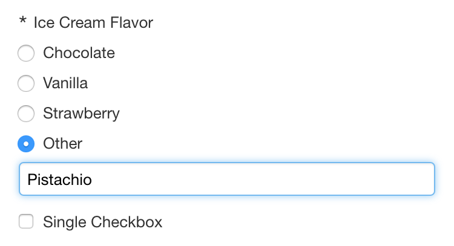

# Open selection component

## Availability

\[SINCE Orbeon Forms 2016.1]

## What it does

The `fr:open-select1` component presents:

* a list of radio buttons predefined by the form author
* and a custom choice ("Other") which the user has the option to specify instead

<figure></figure>

## Usage

You use `fr:open-select1` like a regular `xf:select1` control:

```markup
<fr:open-select1 id="flavor" bind="flavor-bind">
    <xf:label>Make your selection</xf:label>
    <xf:item>
        <xf:label>Chocolate</xf:label>
        <xf:value>chocolate</xf:value>
    </xf:item>
    <xf:item>
        <xf:label>Vanilla</xf:label>
        <xf:value>vanilla</xf:value>
    </xf:item>
    <xf:item>
        <xf:label>Strawberry</xf:label>
        <xf:value>strawberry</xf:value>
    </xf:item>
</fr:open-select1>
```

## Advanced usage

`fr:open-select1` supports the following attributes:

* `appearance`
  * `full`: shows radio buttons (the default)
  * `minimal`: shows a dropdown menu

This is the control with the `minimal` appearance:

<figure></figure>

## Data format

The predefined radio buttons have a _label_ and a _value_, and, like all radio buttons, store their _value_ into the data.

The text of the custom choice entered by the user is saved directly into the data.
