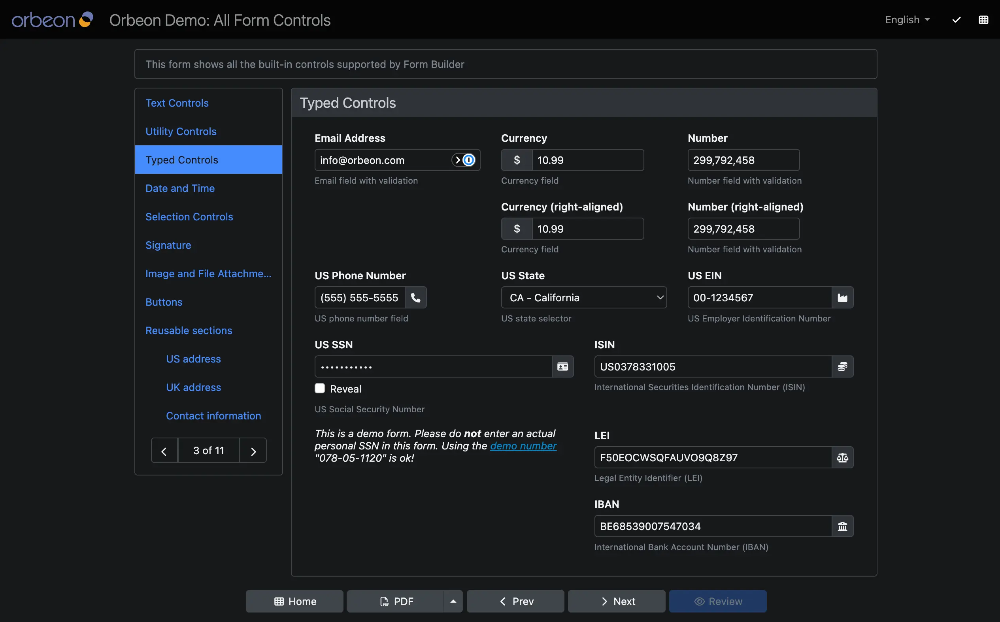
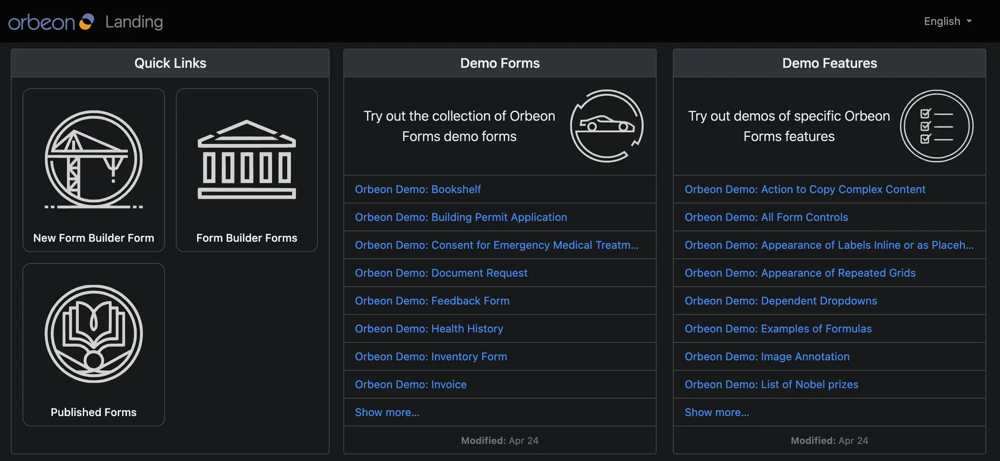
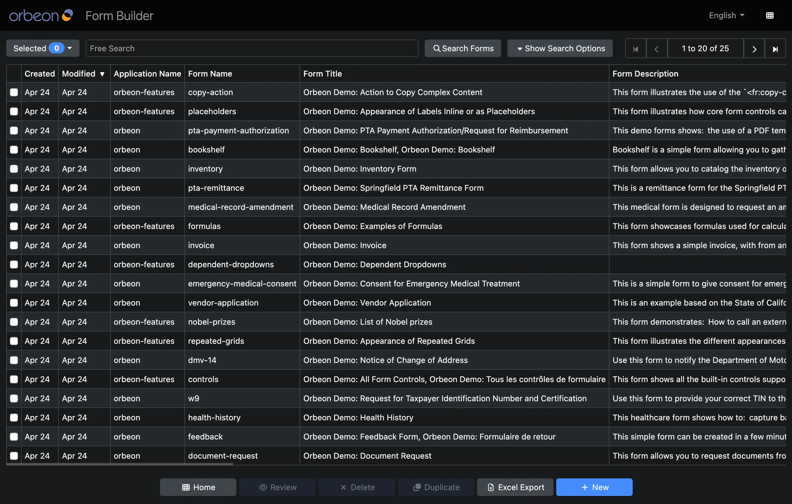

v# Dark mode

## Availability

* [\[SINCE Orbeon Forms 2025.1\]](../../release-notes/orbeon-forms-2025.1.md) Dark color scheme support and initial configuration properties.
* [\[SINCE Orbeon Forms 2026.1\]](../../release-notes/orbeon-forms-2026.1.md) Navigation bar color scheme selector, runtime selection via URL parameter, cookie, and session.

## Overview

Orbeon Forms provides dark mode support across Form Runner. When enabled, a modern, high-contrast dark theme is applied to form views and administrative pages, making forms more comfortable to view in low-light environments and aligning with system-wide dark mode preferences.

Dark mode is available for the following Form Runner pages:

* **Detail page**: Form view, edit, and new modes
* **Summary page**: Form data summary table
* **Landing page**: Application landing page
* **Published Forms page**: Listing of published forms
* **Forms Admin page**: Form management and admin operations







## Navigation bar color scheme selector

[\[SINCE Orbeon Forms 2026.1\]](../../release-notes/orbeon-forms-2026.1.md)

### User interface

Form Runner includes a color scheme selector in the top [navigation bar](navbar.md) next to the language selector:

- The selector dropdown displays an icon matching the active mode:
  - Sun icon: Light mode
  - Moon icon: Dark mode
  - Half-circle icon: Auto (system preference)
- The dropdown menu allows users to switch between three options:
  - **Light**: Forces the light color scheme.
  - **Dark**: Forces the dark color scheme.
  - **Auto**: Automatically follows the user's operating system or browser preference (`prefers-color-scheme`).

Selecting an option switches the color scheme dynamically without reloading the page.

### Persistence

When a user selects a color scheme from the navigation bar, their choice is saved to:

1. A cookie named `fr-color-scheme` (with `path=/; max-age=31536000; SameSite=Lax`).
2. Browser `localStorage` under `orbeon-color-scheme`.

This preference is remembered across page navigations, form submissions, and subsequent visits.

### Configuration

The navigation bar color scheme selector is enabled by default for all Form Runner forms:

```xml
<property
    as="xs:boolean"
    name="oxf.fr.navbar.color-scheme-selector.enable.*.*"
    value="true"/>
```

You can disable the selector globally or per application/form by setting the property to `false`:

```xml
<property
    as="xs:boolean"
    name="oxf.fr.navbar.color-scheme-selector.enable.*.*"
    value="false"/>
```

Form Builder explicitly disables this selector by default:

```xml
<property
    as="xs:boolean"
    name="oxf.fr.navbar.color-scheme-selector.enable.orbeon.builder"
    value="false"/>
```

The selector is automatically hidden in the following situations:

* When running in `test` mode (`fr:mode() = 'test'`)
* When the form is [embedded](../link-embed/) into another page or application (`fr:is-embedded()`)

## Color scheme determination at runtime

[\[SINCE Orbeon Forms 2026.1\]](../../release-notes/orbeon-forms-2026.1.md)

When Form Runner renders a page, the effective color scheme (`light`, `dark`, or `system`) is determined according to the following order of precedence:

1. **URL parameter**: If the `fr-color-scheme` query parameter is present in the request URL (e.g. `?fr-color-scheme=dark` or `?fr-color-scheme=system`), its value is used. This allows external applications or portal links to explicitly request a specific scheme.
2. **Cookie**: If the `fr-color-scheme` cookie is present (such as when set by the navigation bar selector), its value is used.
3. **Session attribute**: If the `fr-color-scheme` attribute is set on the HTTP servlet session, its value is used.
4. **Configuration properties**: If none of the above are set, the value of the `oxf.fr.style.color-scheme` property is used (see below).
5. **Default**: If no property is configured, Form Runner defaults to `light`.

## Configuration properties

### Default color scheme

[\[SINCE Orbeon Forms 2025.1\]](../../release-notes/orbeon-forms-2025.1.md)

You can set the default color scheme used when no user selection, cookie, or URL parameter is present.

Supported values:

* `light` (default): Light color scheme.
* `dark`: Dark color scheme.
* `system`: Automatically selects between light and dark schemes based on the user's browser or operating system preference.

For Form Runner Detail pages, configure `oxf.fr.style.color-scheme.*.*`:

```xml
<property
    as="xs:string"
    name="oxf.fr.style.color-scheme.*.*"
    value="system"/>
```

You can customize this per application and form name using the standard property wildcards (e.g., `oxf.fr.style.color-scheme.acme.order`).

For other pages (Summary, Landing, Published Forms, and Forms Admin pages), use the property without wildcards:

```xml
<property
    as="xs:string"
    name="oxf.fr.style.color-scheme"
    value="system"/>
```

### Navigation bar selector enable

[\[SINCE Orbeon Forms 2026.1\]](../../release-notes/orbeon-forms-2026.1.md)

Controls whether the color scheme selector appears in the navigation bar.

```xml
<property
    as="xs:boolean"
    name="oxf.fr.navbar.color-scheme-selector.enable.*.*"
    value="true"/>
```

## Limitations

* **Form Builder**: Form Builder currently supports only the light color scheme.

## See also

* [Form Runner navigation bar](navbar.md)
* [Color scheme property](../../configuration/properties/form-runner-detail-page.md#color-scheme)
* [CSS customization and CSS variables](../styling/css.md#overriding-css-variables)
* [Release notes for Orbeon Forms 2025.1](../../release-notes/orbeon-forms-2025.1.md)
* [Release notes for Orbeon Forms 2026.1](../../release-notes/orbeon-forms-2026.1.md)
* Blog post: [User interface dark mode](https://www.orbeon.com/2026/05/dark-mode)
